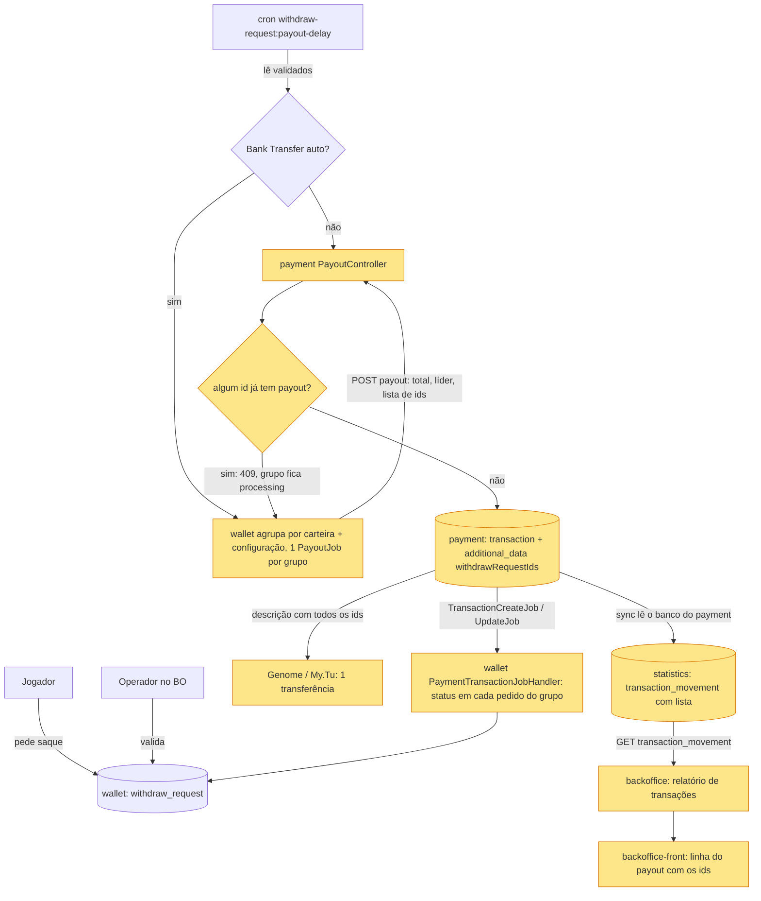

# CLS-1214 — understand

## explain CLS-1214 — 2026-11-13 14:13

### Objetivo

Hoje cada pedido de saque de um player vira uma transferência bancária separada, e cada transferência
paga a sua taxa. O CLS-1214 faz o player com vários saques aprovados receber **uma** transferência com
o total: uma taxa por grupo, não por pedido.

### Premissas

1. **Pedido de saque** (withdrawal request) é o registro que o player cria ao pedir um saque, com
   valor e status próprios. Ele pode ter vários abertos ao mesmo tempo (`notes.md`, "O fluxo" 1).
2. **Payout** é o envio do dinheiro ao provedor de pagamento (Genome ou My.Tu), que faz a
   transferência para a conta do player. Quem envia é o job `withdraw-request:payout-delay` da wallet,
   hoje um payout por pedido: `celesta-wallet/src/AppBundle/Command/PayoutDelayCommand.php:112-125`
   lê os pedidos pagáveis e percorre um a um.
3. O payment recusa (409) um segundo payout para o mesmo pedido, procurando pelo id dele:
   `celesta-payment/src/PaymentProcessBundle/Repository/TransactionRepository.php:846`.
   Hoje ele só conhece **um** id por payout.
4. O relatório de transações do BO mostra, na linha do payout, o id do pedido de saque. A cadeia é
   payment → statistics (`celesta-statistics/src/ApiBundle/Entity/TransactionMovement.php:32`) →
   backoffice (`celesta-backoffice/src/GatewayBundle/Normalizer/Finance/TransactionReportNormalizer.php:97`)
   → front. Cada elo carrega hoje um id só.
5. Para o player nada muda: no site os pedidos continuam separados, cada um com status e email
   próprios (`notes.md`, "Aviso ao player").
6. Só entra Bank Transfer automático; o grupo é por carteira + configuração de pagamento (gate 1,
   Q1, `drafts/CLS-4755.md`).

### Inferência

Por isso, juntar os pedidos não é mudança só na wallet: todo elo que hoje carrega "um id" passa a
carregar "uma lista de ids". Um deles, o de menor id, segue como **líder** no campo antigo, para quem
ainda não lê a lista continuar funcionando.

```
player pede 3 saques: 4290150 (1000), 4292746 (2000), 4301966 (1000)
        │
operador valida cada um no BO                      (igual hoje)
        │
job payout-delay da wallet                         CLS-4755
  agrupa: mesma carteira + configuração, Bank Transfer auto
  monta 1 payout: total 4000, líder 4290150, lista [4290150, 4292746, 4301966]
        │
payment                                            CLS-4753
  aceita a lista; 409 se qualquer id já tem payout
  descrição no banco: "4290150, 4292746, 4301966"
        │
provedor (Genome / My.Tu) → 1 transferência de 4000, 1 taxa
        │
payment avisa a wallet → paid ou error vale para o grupo inteiro
        │                       └ cada pedido recebe o seu status e o seu email
statistics guarda a lista no movimento             CLS-4754
        │
backoffice expõe a lista na linha do relatório     CLS-4756
        │
front mostra a lista                               CLS-4757
        │
só então: backoffice tira o id único               CLS-4758 (cleanup)
```

A ordem dos Blocks sai do mesmo desenho: cada sub-task lê o contrato da anterior (4753 → 4754 ∥ 4755;
4754 → 4756 → 4757 → 4758). O deploy segue a ordem inversa do risco: payment antes da wallet, porque
um payment velho ignora a lista calado e pagaria o total só ao líder, deixando os outros em
`processing` (`drafts/CLS-4753-contract.md`, "Deploy order").

### O que falta

- Plano do 4753 commitado local, push pendente; 4754–4757 têm branch local e nada escrito
  (`sdd.md`, Estado 13:32). O passo atual é esse: plan-write.
- 4758 adiado de propósito: o plano só sai com o 4757 em produção (`sdd.md`, Decisões 2026-11-13).
- Os arquivos `drafts/*-contract.md` estão velhos: falam em teto de 10 ids e constante na biblioteca,
  e o gate 1 decidiu sem teto (Q5). Os planos (`drafts/CLS-4753.md:20`) já estão certos.
- `notes.md` diz "mesma moeda"; o gate 1 diz "carteira + configuração". Não conferi se carteira
  equivale a moeda.

## flow CLS-1214 — 2026-11-13 14:15



Em destaque: todo ponto que hoje carrega um id de pedido e passa a carregar a lista (wallet 4755, payment 4753,
statistics 4754, BO 4756/4758, front 4757). Fora do destaque, jogador, validação no BO, cron e a decisão do
método seguem iguais. Fontes no origin/master: `PayoutDelayCommand.php:249`, `PayoutController.php:400`,
`TransactionSubscriber.php` (jobs), statistics `TransactionMovementManager.php:35,311` (lê o banco do payment).
