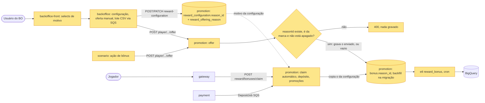

# flow CLS-3316 — 2026-11-16 07:23

Em destaque está onde o motivo passa a ser escolhido, validado, copiado e gravado: hoje ele existe só na configuração (`RewardConfiguration.php:179`), e o etl o lê de lá (`bigquery_copy_mysql_to_global.py:98,107`).

Todo bônus nasce no `RewardOfferService` da promotion, por duas entradas: o endpoint `offer` (BO manual, lote CSV via `OfferFreeBonusHandler` e cenário) e o claim (gateway, e `DepositJobHandler` / `SuccessfulDepositJobHandler` no depósito).

O `scenario` também está em destaque porque a spec o inclui, mas nenhuma das 6 sub-tasks é desse repositório.
