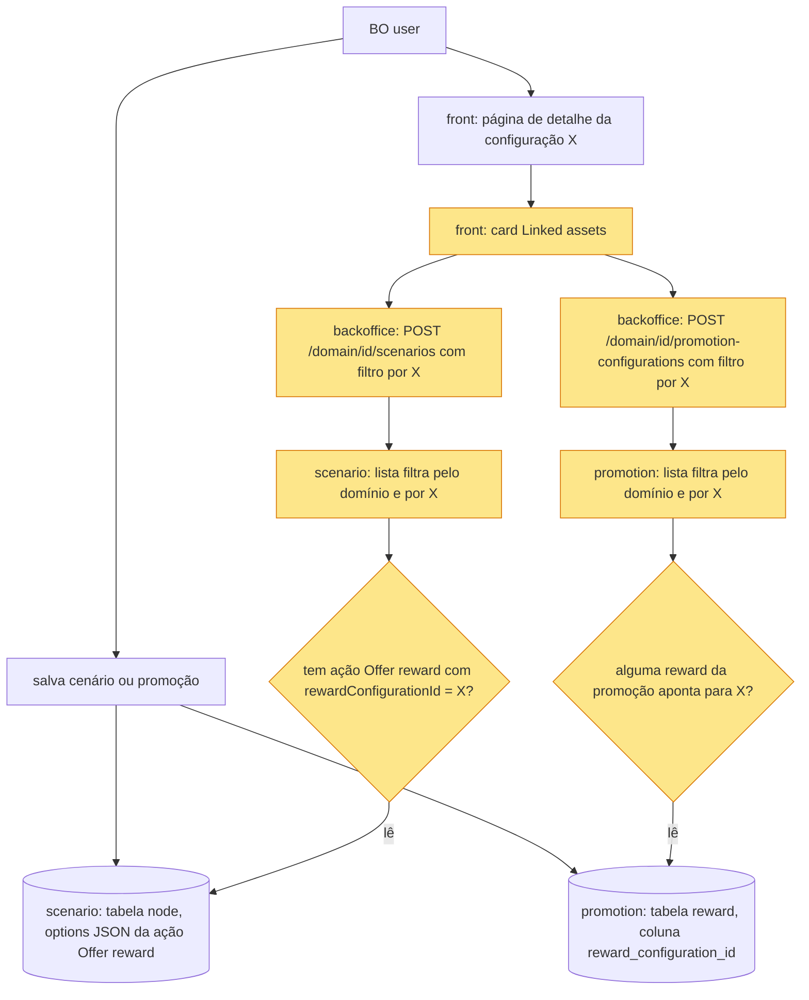

# flow CLS-4742 — 2026-11-16 07:33

Em destaque está o caminho de leitura novo. Nos dois serviços, a lista ganha o filtro "usa X?", o backoffice repassa esse filtro e o front monta o card. É o mesmo desenho que o card de segmento já usa (`SegmentLinkedAssets.js`, que chama essas duas listas com `segmentIds`).

O ticket não grava nada. A ligação com a configuração já é gravada quando alguém salva o cenário ou a promoção, e isso continua igual.

Uma ressalva para o plano: o nome do parâmetro do filtro ainda não existe. Também não conferi o nome exato da tabela-filha das ações no scenario: a entidade `ActionNode` herda de `node` e guarda as `options` numa coluna JSON.
